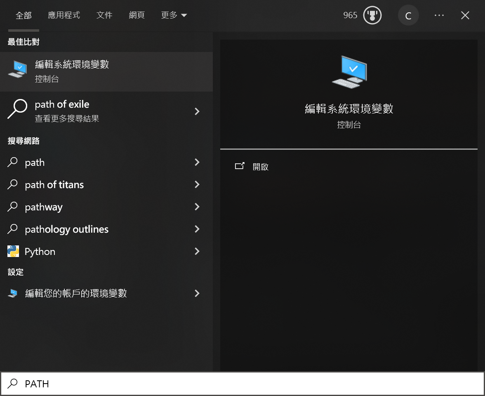
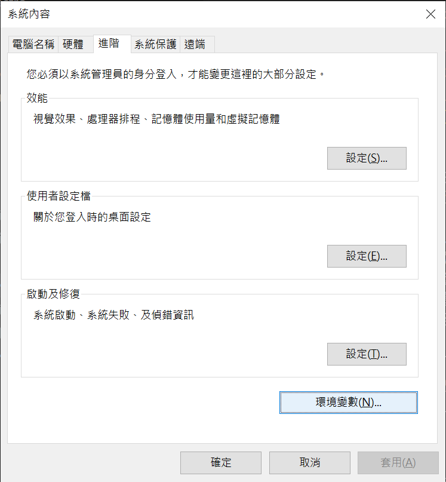
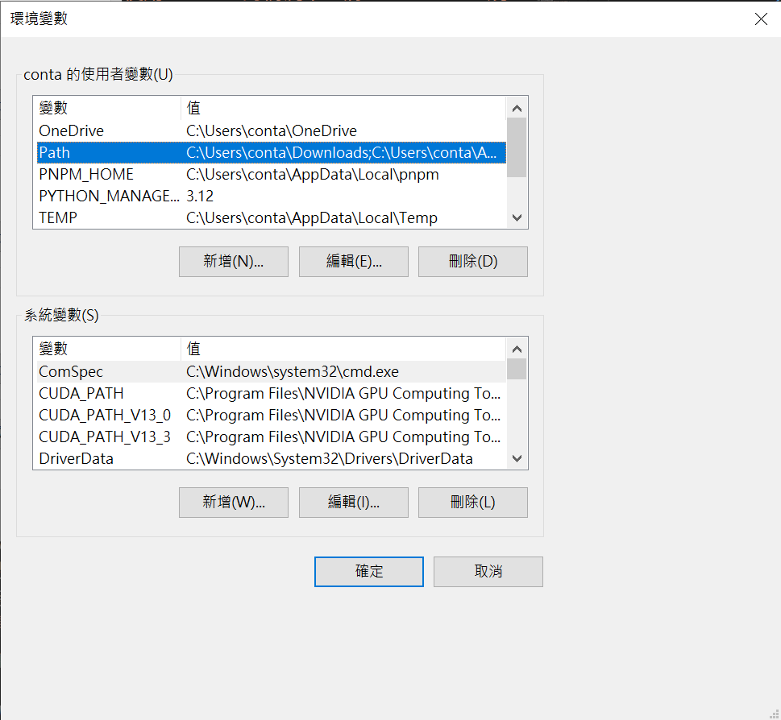
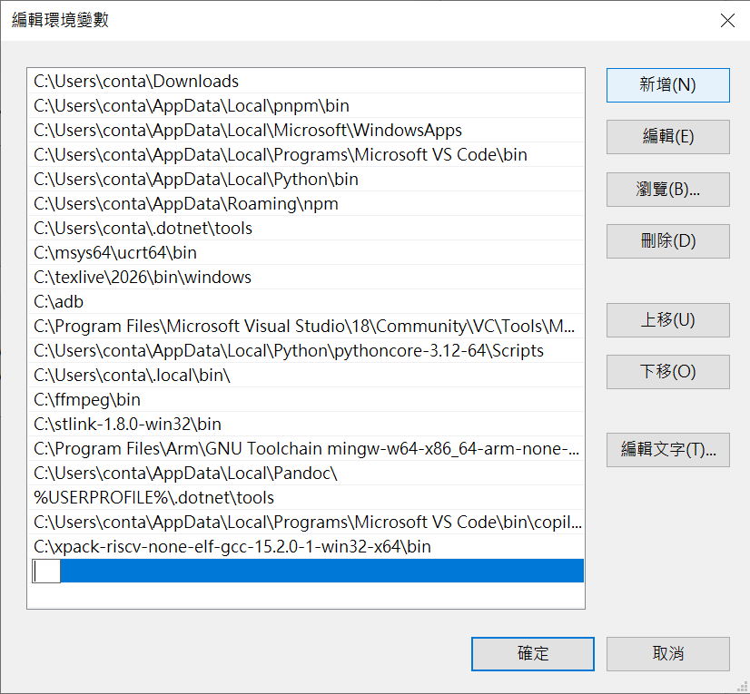

> 本篇文章將簡述如何在 Windows 中將路徑加入環境變數，方便在命令列中執行程式。

## 一、將路徑加入系統環境變數
1. 在桌面上按下 `Win + S`，搜尋 `PATH`，並點擊「編輯系統環境變數」。
    

2. 在系統內容視窗中，點擊「環境變數(N)...」按鈕。
    

3. 在環境變數視窗中，找到使用者變數區塊中的 `Path` 變數，並點擊「編輯(E)...」按鈕。
    

4. 在編輯環境變數視窗中，點擊「新增(N)」按鈕，並輸入你想要加入的路徑，最後點擊「確定」按鈕。
    

5. 完成後，依序點擊「確定」按鈕，關閉所有視窗。
