> 本篇文章將簡述如何在不使用 Vitis 的情況下，將 Bitstream 燒錄至 Cmod-A7 開發板上。

## 一、安裝 OpenFPGALoader
OpenFPGALoader 是一款跨平台的 FPGA 程式設計工具，相容於眾多主流廠商的 FPGA 及開發版，並且可在 Linux、Windows 和 macOS 系統上運作，在這份教學中，我們將使用 OpenFPGALoader 來將 Bitstream 燒錄至 Cmod-A7 開發板上。

以下安裝教學參考自官方網站上的安裝說明：[https://trabucayre.github.io/openFPGALoader/guide/install.html](https://trabucayre.github.io/openFPGALoader/guide/install.html)

### Windows
請先確保你的電腦已安裝 [MSYS2](https://www.msys2.org)，你可以透過搜尋 `MSYS2 UCRT64` 來確認你是否已經安裝好 MSYS2，若尚未安裝，請依照官方網站上的教學進行安裝。
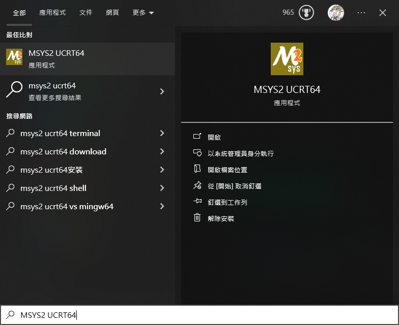

安裝完成後，開啟 MSYS2 UCRT64 終端機，並輸入以下命令來安裝 OpenFPGALoader：
```bash
pacman -S mingw-w64-ucrt-x86_64-openFPGALoader
```
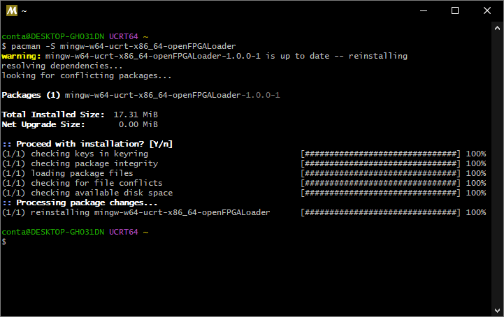

等待它安裝完成之後，開啟終端機並輸入以下命令來確認 OpenFPGALoader 是否安裝成功：
```bash
openFPGALoader -V
```
如果安裝成功，終端機會顯示 OpenFPGALoader 的版本資訊，如下圖所示。
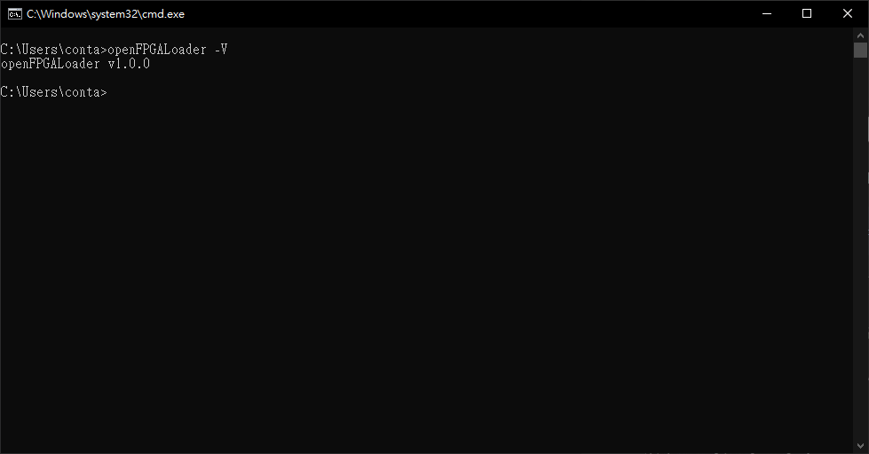

:::info
如果沒有出現 OpenFPGALoader 的版本資訊，請嘗試將 UCRT64 的路徑加入系統環境變數中，如果在安裝 MSYS2 的過程中沒有修改安裝位置的話，UCRT64 的路徑預設為 `C:\msys64\ucrt64\bin`，請將此路徑加入系統環境變數中，並重新開啟終端機後再次輸入 `openFPGALoader -V` 來確認是否安裝成功。
:::
:::extend
延伸閱讀：[在 Windows 中將路徑加入環境變數](../../basic/windows-add-to-path)
:::

### macOS
開啟終端機並輸入以下指令來透過 Homebrew 安裝 OpenFPGALoader：
```bash
brew install openfpgaloader
```

## 二、替換 USB 驅動程式（僅 Windows）
> 由於 OpenFPGALoader 需要使用 libusb 來與 Cmod-A7 開發板進行通訊，因此我們需要替換掉 Windows 預設的 USB 驅動程式，改為使用 libusb 的驅動程式。

:::warning
替換 USB 驅動程式後，可能無法同時使用 Vivado 或是 Vitis 進行燒錄或偵錯，如果在替換後想要恢復，請參考[如果替換錯設備怎麼辦？](#如果替換錯設備怎麼辦) 來還原驅動程式。
:::

下載並執行 [Zadig](https://zadig.akeo.ie/) 工具，並依照以下步驟進行操作：
1. 在 Zadig 工具中，點擊「Options」選單，並勾選 「List All Devices」選項。
    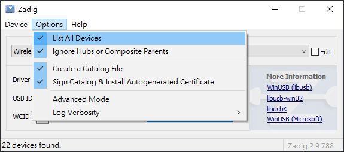

2. 在下拉選單中找到 `Digilent Adept USB Device (Interface 0)`，並選擇它。
    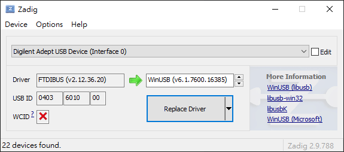

    :::info
    如果你在下拉選單中找不到 `Digilent Adept USB Device (Interface 0)`，請嘗試先關閉 Zadig 工具，然後重新插拔 Cmod-A7 開發板，並再次開啟 Zadig 工具。
    :::
    :::warning
    請選擇 `Digilent Adept USB Device (Interface 0)`，而不是 `Digilent Adept USB Device (Interface 1)`，否則可能會導致燒錄失敗。
    :::

3. 確認右側的驅動為 `WinUSB`，然後點擊「Replace Driver」按鈕來替換驅動程式，過程可能需要一點時間。
    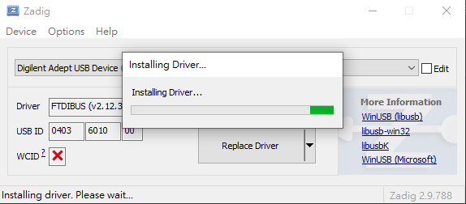
    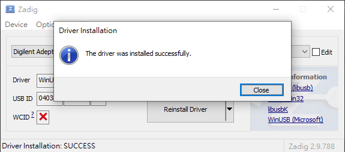

### 如果替換錯設備怎麼辦？
如果你不小心替換了錯誤的設備，請依照以下步驟來還原驅動程式：
1. 搜尋並開啟「裝置管理員」
    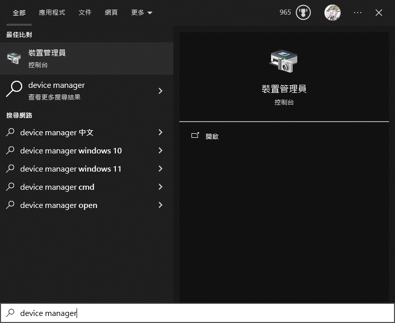

2. 尋找「通用序列匯流排裝置」或是「Universal Serial Bus devices」。
    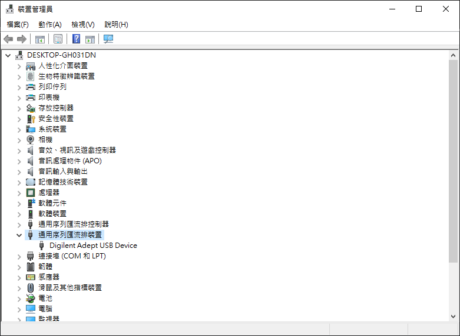

3. 將其中的設備右鍵點擊，並選取「解除安裝裝置」。
    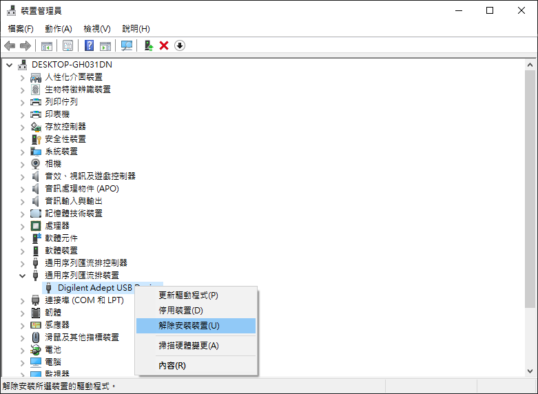

4. 解除安裝後，重新插拔安裝錯的設備，Windows 會自動重新安裝原本的驅動程式，這樣就可以還原驅動程式了。


## 三、測試連線
在終端機中輸入以下命令來尋找 USB 設備：
```bash
openFPGALoader -scan-usb
```

如果順利的話，終端機中會出現類似下列的訊息：
```
empty
Bus device vid:pid       probe_type manufacturer serial       product
004 032    0x0403:0x6010 FTDI2232   Digilent     210328BF9BB8 Digilent Adept USB Device
```

:::info
如果你的終端機中出現以下訊息，請檢查是否已經替換 USB 驅動程式，或是檢查 Cmod-A7 開發板是否已經正確連接到電腦上。
```
empty
Error: can't open device with vid:vid = 0x0403:0x6010. Error code -5 Entity not found
Bus device vid:pid       probe_type manufacturer serial product
```
:::

接下來，輸入以下命令檢查是否有正確識別到 Artix-7 FPGA：
```bash
openFPGALoader -c digilent --detect
```

終端機中會出現已連接的 FPGA 型號：
```
empty
Jtag frequency : requested 6.00MHz    -> real 6.00MHz   
index 0:
        idcode 0x362d093
        manufacturer xilinx
        family artix a7 35t
        model  xc7a35
        irlength 6
```

接著就可以嘗試將 Bitstream 燒錄至 Cmod-A7 開發板上：
```bash
openFPGALoader -b cmoda7_35t release/boot_srec.bit
```
:::info
Bitstream 可以從 GitHub 上的專案中下載。
:::

燒錄完成後，開發板上的橘色 LED 及 RGB LED 會亮起，表示燒錄成功。
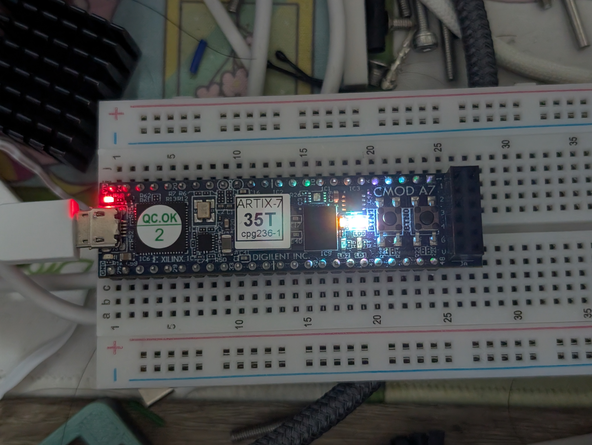

:::info
以上的命令是直接將 Bitstream 燒錄至 FPGA 中，但 FPGA 的配置會在斷電後消失，因此如果想要在每次上電時自動載入 Bitstream，請使用以下命令將 Bitstream 燒錄至 SPI Flash 中，讓 FPGA 在上電時自動從 Flash 中載入 Bitstream：
```bash
openFPGALoader -b cmoda7_35t -f --verify release/boot_srec.bit
```
:::

## 四、結語
以上就是在不使用 Vitis 的情況下，將 Bitstream 燒錄至 Cmod-A7 開發板上的教學，透過 OpenFPGALoader 工具，我們可以輕鬆地將 Bitstream 燒錄至 FPGA 中，並且可以選擇將 Bitstream 燒錄至 SPI Flash 中，讓 FPGA 在每次上電時自動載入 Bitstream，這樣就可以在不使用 Vitis 的情況下，快速地將 Bitstream 燒錄至 Cmod-A7 開發板上，並且可以在每次上電時自動載入 Bitstream，方便我們進行開發與測試。

<PrevNext next="./02-asm-build-and-flash.mdx" />
