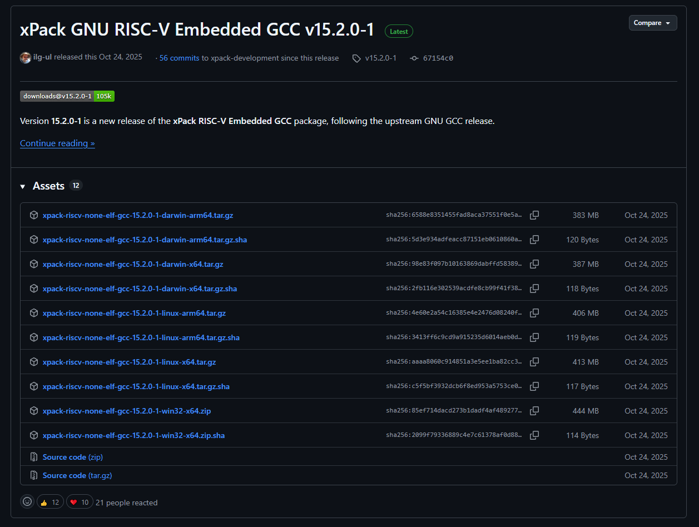
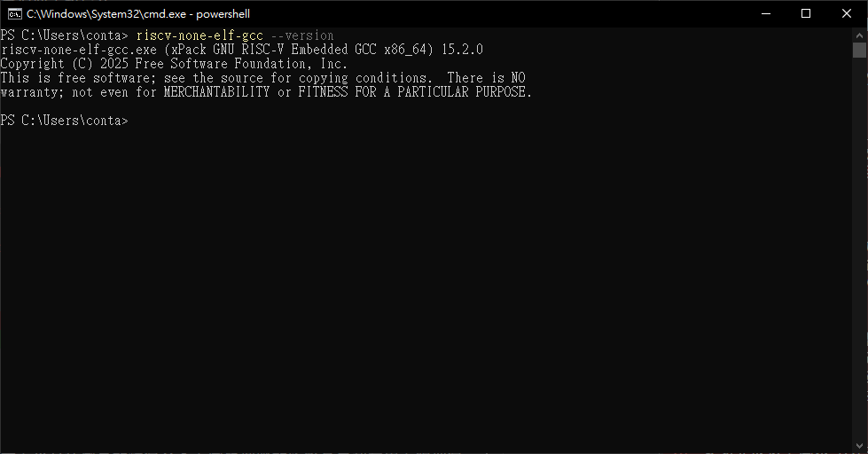
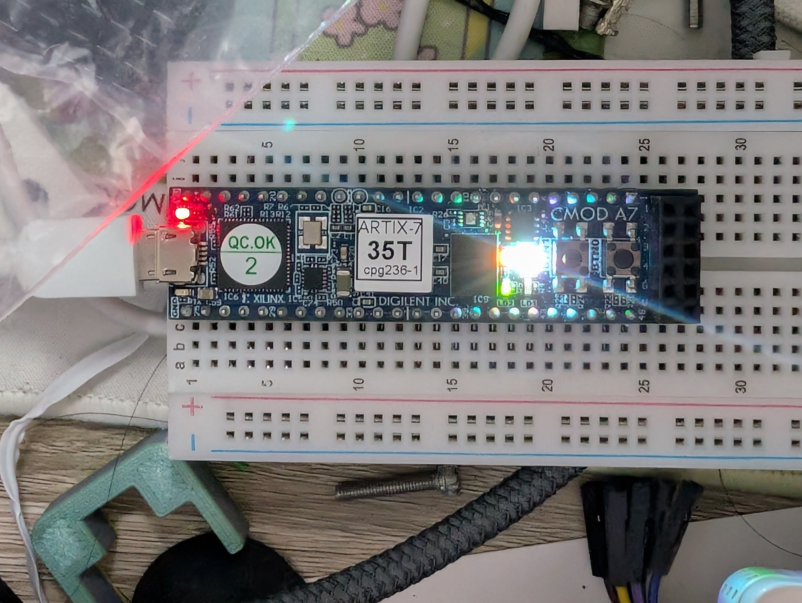

> 本篇文章將簡述如何在不使用 Vitis 的情況下，將程式進行組譯並燒錄至 Cmod-A7 開發板上。

## 一、安裝 RISC-V 工具鏈
RISC-V 工具鏈是一套用於 RISC-V 架構的開發工具，包括編譯器、組譯器、鏈接器等。在這份教學中，我們將使用由 xPack 預編譯的 RISC-V GNU 工具鏈來進行組譯，並將組譯後的程式燒錄至 Cmod-A7 開發板上。

請先前往 [https://github.com/xpack-dev-tools/riscv-none-elf-gcc-xpack/releases/latest](https://github.com/xpack-dev-tools/riscv-none-elf-gcc-xpack/releases/latest) 按照自己的作業系統下載對應的 RISC-V 工具鏈。

| 後綴 | 作業系統 |
| --- | --- |
| darwin-arm64 | macOS (Apple Silicon) |
| darwin-x64 | macOS (Intel) |
| linux-arm64 | Linux (ARM) |
| linux-x64 | Linux (Intel) |
| win32-x64 | Windows |



下載完成之後請將壓縮檔解壓縮至你想要安裝的目錄，並將該目錄加入系統環境變數中。

### Windows
解壓縮後會有一個 `xpack-riscv-none-elf-gcc` 的資料夾，你可以先將資料夾移動到使用者目錄下，例如 `C:\Users\<your_username>\riscv-none-elf-gcc`。
```
C:\Users\<your_username>\riscv-none-elf-gcc
├─ bin
│   ├─ riscv-none-elf-gcc.exe
│   ├─ riscv-none-elf-gdb.exe
│   ├─ riscv-none-elf-objcopy.exe
│   ├─ riscv-none-elf-objdump.exe
│   └─ ...
├─ include
├─ lib
├─ share
└─ ...
```

接下來請將 `bin` 資料夾的路徑加入系統環境變數中，例如 `C:\Users\<your_username>\riscv-none-elf-gcc\bin`。

:::extend
延伸閱讀：[在 Windows 中將路徑加入環境變數](../../basic/windows-add-to-path)
:::

完成之後請重新啟動終端機，並輸入以下命令來確認 RISC-V 工具鏈是否安裝成功：
```bash
riscv-none-elf-gcc --version
```



### macOS/Linux
請使用以下命令將壓縮檔解壓縮：
```bash
tar -xzf xpack-riscv-none-elf-gcc-*.tar.gz
```

接下來你可以將解壓縮後的目錄移到 `/opt` 目錄下：
```bash
sudo mv xpack-riscv-none-elf-gcc-* /opt/riscv-none-elf-gcc
```

並將 `bin` 資料夾的路徑加入系統環境變數中，例如：
```bash
echo 'export PATH=/opt/riscv-none-elf-gcc/bin:$PATH' >> ~/.zshrc
source ~/.zshrc
```
:::info
請依照你使用的 shell 來修改對應的設定檔，例如 `~/.bashrc`、`~/.zshrc` 等。
:::

完成之後請輸入以下命令來確認 RISC-V 工具鏈是否安裝成功：
```bash
riscv-none-elf-gcc --version
```


## 二、專案目錄簡介
在本篇教學中，我們將使用以下的目錄結構並搭配 Makefile 來進行組譯與燒錄：

```bash
example/
├─ build/
│  ├─ example.elf
│  ├─ example.hex
│  ├─ example.lst
│  └─ example.map
├─ src/
│  └─ main.S
├─ include/
│  ├─ cmod_mcu.h
│  └─ cmod_mcu.ld
└─ Makefile
```

關於各個資料夾及檔案的說明如下：
- `build/`：存放組譯後的檔案，包括 ELF、HEX、LST、MAP 等檔案。
    - `example.elf`：組譯後的 ELF 檔案，包含程式的機器碼、符號表、段資訊等。
    - `example.hex`：組譯後的 HEX 檔案，由 `objcopy` 工具將 ELF 檔案轉換而來，用於燒錄至 FPGA 的 Flash 中。
    - `example.lst`：組譯後的 LST 檔案，由 `objdump` 工具將 ELF 檔案轉換而來，用於查看程式的組譯結果。
    - `example.map`：組譯後的 MAP 檔案，由 `riscv-none-elf-gcc` 工具生成，用於查看程式的記憶體配置。
- `src/`：存放程式的原始碼檔案。
    - `main.S`：程式的主程式檔案，使用組合語言撰寫。
- `include/`：存放程式的標頭檔案。
    - `cmod_mcu.h`：在 GitHub 上提供的 Cmod-A7 開發板的 MCU 標頭檔案，包含 MCU 的記憶體映射、暫存器定義等。
    - `cmod_mcu.ld`：在 GitHub 上提供的 Cmod-A7 開發板的 MCU 連結描述檔案，包含程式的記憶體配置、段資訊等。
- `Makefile`：用於自動化組譯與燒錄的 Makefile 檔案，包含組譯、轉換、燒錄等指令。

在此步驟中，請先創建一個新的資料夾，在資料夾中新增 `src` 及 `include` 資料夾，並將 `cmod_mcu.h` 與 `cmod_mcu.ld` 下載至 `include/` 資料夾中。


## 三、撰寫程式、組譯與燒錄
### 範例程式
在此次教學中，將使用以下程式進行測試，此程式會以 0.5 秒的間隔閃爍 Cmod-A7 開發板上的 LED1 及 LED2，請將以下程式碼存放至 `src/main.S` 檔案中：
```
#include "cmod_mcu.h"
#define DELAY_LOOPS     12500000

    .section .text.init, "ax"
    .globl  _boot
_boot:
    csrci   mstatus, 0x8
    li      t0, INTC_BASE
    sw      zero, INTC_MER(t0)
    sw      zero, INTC_IER(t0)
    la      sp, __stack
    li      s0, LED_BASE
    sw      zero, GPIO_TRI(s0)
    li      s1, 0x1

loop:
    sw      s1, GPIO_DATA(s0)
    xori    s1, s1, 0x3
    li      t1, DELAY_LOOPS
delay:
    addi    t1, t1, -1
    bnez    t1, delay
    j       loop
```

### Makefile
接下來，請將以下程式碼放至 `Makefile` 檔案中：
```makefile
MKFILE_PATH := $(abspath $(lastword $(MAKEFILE_LIST)))
MKFILE_DIR  := $(dir $(MKFILE_PATH))
PROJ_NAME   := $(notdir $(patsubst %/,%,$(MKFILE_DIR)))
BUILD_DIR   := build
INC_DIR     := $(MKFILE_DIR)include
SRCS        := $(wildcard src/*.S)
# ---- toolchain ----
CROSS       ?= riscv-none-elf-
CC          := $(CROSS)gcc
OBJCOPY     := $(CROSS)objcopy
OBJDUMP     := $(CROSS)objdump
SIZE        := $(CROSS)size
# ---- FLAGS ----
ARCH        := -march=rv32im_zicsr_zba_zbb_zbc_zbs -mabi=ilp32
LDFLAGS     := -nostdlib \
               -nostartfiles \
               -T $(INC_DIR)/cmod_mcu.ld \
               -Wl,-Map=$(BUILD_DIR)/$(PROJ_NAME).map \
               -Wl,--no-warn-rwx-segments
# ---- flash ----
LOADER      ?= openFPGALoader
BOARD       := cmoda7_35t
OFFSET      := $(shell printf "%d" 0x220000)
# ---- targets ----
ELF         := $(BUILD_DIR)/$(PROJ_NAME).elf
SREC        := $(BUILD_DIR)/$(PROJ_NAME).hex
READBACK    := $(BUILD_DIR)/readback.hex

.PHONY: all flash reset clean

all: $(SREC) $(BUILD_DIR)/$(PROJ_NAME).lst
	@$(SIZE) $(ELF)
	@echo "BUILD OK  entry 0x$$(sed -n 's/^S705\(.\{8\}\).*/\1/p' $(SREC))"

$(BUILD_DIR):
	mkdir -p $@

$(ELF): $(SRCS) $(INC_DIR)/cmod_mcu.h $(INC_DIR)/cmod_mcu.ld | $(BUILD_DIR)
	$(CC) $(ARCH) -I$(INC_DIR) $(LDFLAGS) -o $@ $(SRCS)

$(BUILD_DIR)/$(PROJ_NAME).lst: $(ELF)
	$(OBJDUMP) -d $< > $@

$(SREC): $(ELF)
	$(OBJCOPY) -O srec $< $@
	@if grep -E '^S3..0000[0-7]' $@; then \
	    echo "error: SREC has records below 0x8000 (would overwrite the bootloader)"; \
	    rm -f $@; exit 1; \
	fi

flash: $(SREC)
	$(LOADER) -b $(BOARD) -f --skip-reset -o $(OFFSET) $(SREC)
	$(LOADER) -b $(BOARD) --dump-flash -o $(OFFSET) \
	    --file-size $$(wc -c < $(SREC)) $(READBACK)
	cmp $(SREC) $(READBACK)
	@rm -f $(READBACK)
	@echo "   readback matches"
	$(LOADER) -b $(BOARD) -r
	@echo "FLASH OK  the board now boots this program at every power-on"

reset:
	$(LOADER) -b $(BOARD) -r

clean:
	rm -rf $(BUILD_DIR)
```
:::info
如果要對 Makefile 進行修改的話，請使用 Tab 來縮排，並且不要使用空格來縮排，否則 Makefile 會無法正確執行。
:::

### 組譯並燒錄
接下來，請在終端機中輸入以下命令來進行組譯：
```bash
make
```

順利的話，終端機最後會出現建置成功的訊息：
```
...
riscv-none-elf-objdump -d build/test_proj.elf > build/test_proj.lst
   text    data     bss     dec     hex filename
     64       0       0      64      40 build/test_proj.elf
BUILD OK  entry 0x60000000
```

接下來，請繼續在終端機中輸入以下命令來將組譯後的程式燒錄至 Cmod-A7 開發板上：
```bash
make flash
```

燒錄完成後，終端機中會出現燒錄成功的訊息：
```
...
cmp build/test_proj.hex build/readback.hex
   readback matches
openFPGALoader -b cmoda7_35t -r
empty
Jtag frequency : requested 6.00MHz    -> real 6.00MHz   
FLASH OK  the board now boots this program at every power-on
```

接著，開發板上的 LED1 及 LED2 會以 0.5 秒的間隔閃爍，表示燒錄成功。


## 四、結語
以上就是在不使用 Vitis 的情況下，將組合語言撰寫的程式進行組譯並燒錄至 Cmod-A7 開發板上的教學，透過 RISC-V 工具鏈，我們可以輕鬆地將程式進行組譯，並且可以選擇將組譯後的程式燒錄至 SPI Flash 中，讓 FPGA 在每次上電時自動載入程式，這樣就可以在不使用 Vitis 的情況下，快速地將程式燒錄至 Cmod-A7 開發板上，並且可以在每次上電時自動載入程式，方便進行開發與測試。

<PrevNext prev="./01-cmod-a7-setup.mdx"/>
